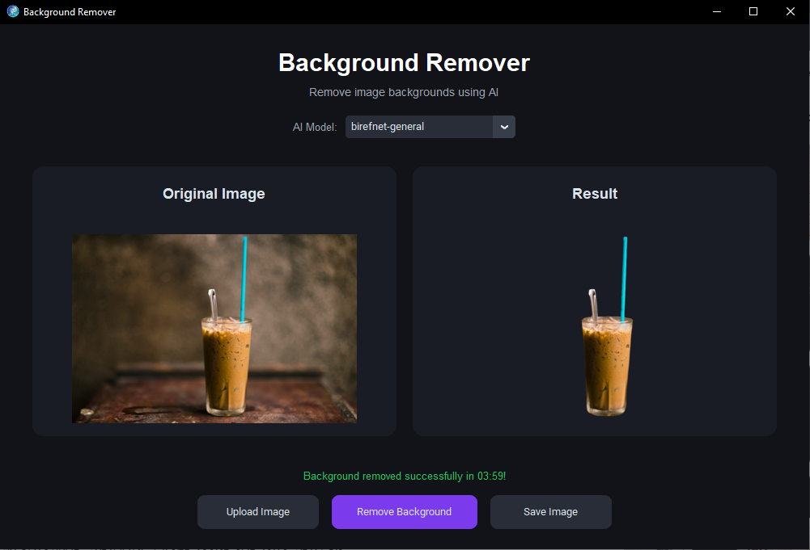

# BackgroundRemover

**An AI-powered Windows desktop application for removing image backgrounds.**

BackgroundRemover is a desktop application built with Python that uses AI segmentation models to remove image backgrounds and generate transparent PNG images.

## Application Interface



*Main application interface — upload an image, preview it, and remove its background.*


## Features

- Select images directly from your computer.
- Preview the original image and the processed result.
- Remove image backgrounds using AI segmentation models.
- Choose between the AI models configured in the application.
- Save processed images as PNG files with transparent backgrounds.
- User-friendly graphical interface built with CustomTkinter.
- Windows desktop application.

## AI Models

The project is configured to support the following rembg models:

- **BiRefNet General** — `birefnet-general`
- **BiRefNet General Lite** — `birefnet-general-lite`
- **U2Net Portrait (Lightweight)** — `u2netp`

**Important:** ONNX model files are excluded from this Git repository because of their large file sizes. Download the required models separately and place them in the directory structure expected by `main.py` and your rembg configuration.

## Built With

| Technology | Purpose |
|---|---|
| Python | Application logic |
| CustomTkinter | Desktop graphical interface |
| Pillow | Image processing |
| rembg | AI background removal |
| ONNX Runtime | AI model execution |
| PyInstaller | Windows executable packaging |

## Project Structure

```text
BackgroundRemover/
│
├── assets/
│   └── icon.ico
│
├── models/
│   └── AI model files (download separately)
│
├── output/
│   └── Processed images
│
├── screenshots/
│   └── main-interface.png
│
├── src/
│   └── main.py
│
├── .gitignore
└── README.md
```

## Installation & Run Locally

### 1. Clone the repository

```bash
git clone https://github.com/Med-lms-dev/BackgroundRemover.git
cd BackgroundRemover
```

### 2. Create a virtual environment

```powershell
py -m venv .venv
```

Activate it:

```powershell
.\.venv\Scripts\Activate.ps1
```

If PowerShell blocks script execution:

```powershell
Set-ExecutionPolicy -Scope Process -ExecutionPolicy Bypass
```

Then activate the environment again.

### 3. Install dependencies

```bash
python -m pip install customtkinter pillow "rembg[cpu]" onnxruntime
```

Alternatively, if a `requirements.txt` file is available:

```bash
python -m pip install -r requirements.txt
```

### 4. Add AI models

Download the ONNX models you want to use and place them in the directory structure expected by your `main.py` and rembg configuration.

Model files are intentionally excluded from this repository.

### 5. Run the application

```bash
python src/main.py
```

If your Windows installation requires custom Tcl/Tk environment variables, use the provided `run.ps1` script.

## Build Windows Application

Install PyInstaller:

```bash
python -m pip install pyinstaller
```

Build the application from the project root:

```powershell
pyinstaller --noconfirm --clean --onedir --windowed --name BackgroundRemover --icon "assets\icon.ico" --add-data "models;models" --add-data "assets;assets" --collect-all rembg --collect-all onnxruntime --collect-all customtkinter --copy-metadata pymatting src\main.py
```

After building, the executable will be located at:

```text
dist/BackgroundRemover/BackgroundRemover.exe
```

**Important:** Distribute the complete `dist/BackgroundRemover` folder, not just the `.exe`, because the application depends on bundled libraries and resources.

Make sure your model paths and local `models` directory match the configuration in `main.py` before building.

## Offline Usage

The application can work offline once all required dependencies, runtime files, and AI models are installed or bundled.

To verify offline functionality, disconnect from the internet and test the application with each configured model.

## Repository

**GitHub:** [Med-lms-dev/BackgroundRemover](https://github.com/Med-lms-dev/BackgroundRemover)

## License

No license has been specified for this repository yet. All rights remain reserved by default unless a license is added.